# Manual de Utilizador FloralQ

---

A **FloralQ** é uma plataforma web de monitorização de plantas que combina **sensores físicos IoT** (humidade do solo e GPS) com um **dashboard web**.
O objetivo é simples: **saber o estado das suas plantas em tempo real**, **prever quando precisam de água** e **gerir múltiplas plantas** a partir de um único ecrã.

---

## Índice

1. [Vista geral](#1-vista-geral)
2. [Requisitos](#2-requisitos)
3. [Criar conta](#3-criar-conta)
4. [Iniciar sessão](4-#iniciar-sessão)
5. [Navegação principal](#5-navegação-principal)
6. [Tutorial de onboarding](#6-tutorial-de-onboarding)
7. [Resgatar um dispositivo](#7-resgatar-um-dispositivo)
8. [Adicionar uma planta](#8-adicionar-uma-planta)
9. [Dashboard e cards de planta](#9-dashboard-e-cards-de-planta)
10. [Detalhes de uma planta](#10-detalhes-de-uma-planta)
11. [Editar e remover plantas](#11-editar-e-remover-plantas)
12. [Conta e definições](#12-conta-e-definições)
13. [Terminar sessão](#13-terminar-sessão)
14. [Boas práticas](#14-boas-práticas)
15. [Resolução de problemas](#15-resolução-de-problemas)

---

## 1. Vista geral   

A FloralQ organiza as suas plantas em **cards no dashboard**. Cada card representa uma planta monitorizada por um sensor físico, e mostra a humidade atual, o estado, a previsão de secagem e o histórico de leituras.   

Dentro da plataforma consegue:   

- **Resgatar dispositivos** (FloralQ Home ou FloralQ Professional) através de um código de ativação.
- **Adicionar plantas** com imagem, nome, localização e tipo de espécie.
- **Monitorizar o estado** de cada planta em tempo real, com atualização automática a cada nova leitura do sensor.
- **Ver previsões de secagem** com indicação do tempo estimado até à próxima rega.
- **Consultar histórico** de humidade em quatro intervalos (24h, semana, mês, ano).
- **Ver localização GPS** das plantas (apenas dispositivos FloralQ Professional).
- **Configurar alertas** de humidade 
- **Personalizar** a apresentação dos gráficos.

---

## 2. Requisitos   

- Computador ou smartphone com ligação à internet.
- Browser.
- Pelo menos um dispositivo FloralQ (Home ou Professional), com acesso à internet, para monitorizar plantas.

---

## 3. Criar conta   

1. Na página de login, clique em **"Don't have an account? Create one"**.
2. Preencha os campos:
   - **Name**, o seu nome
   - **Email**, email válido
   - **Password**, mínimo 6 caracteres
   - **Repeat Password**, confirmação da palavra-passe
3. Clique em **"Create Account"**.
4. Será redirecionado para a página de login para iniciar sessão.   

**Ecrã de referência:**  
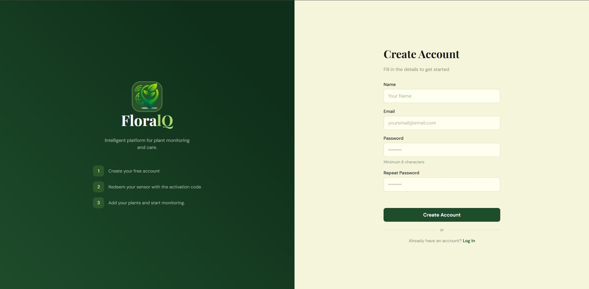   

---

## 4. Iniciar sessão   

1. Aceda à página de login.
2. Introduza:
   - **Email**
   - **Password**
3. (Opcional) Marque **"Remember me"** para guardar o email no browser.
4. Clique em **"Log In"**.

**Ecrã de referência:**   
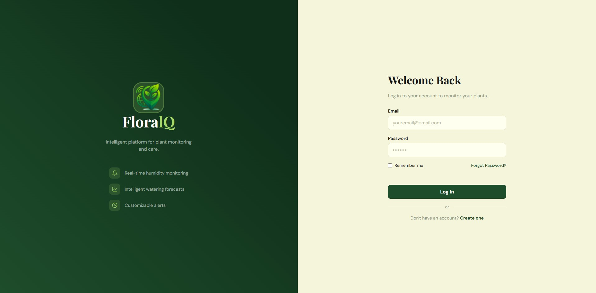   

---

## 5. Navegação principal   

A navegação da plataforma é feita a partir da **barra superior**, sempre visível em todas as páginas:   

- **+ Add Plant** (canto superior direito), abre o formulário para adicionar uma nova planta.
- **Ícone de engrenagem**, abre o menu de definições com acesso a Redeem Device, Account, Dark Mode e Logout.

O conteúdo principal é o **dashboard**, que apresenta as suas plantas em cards.   

**Ecrã de referência:**   
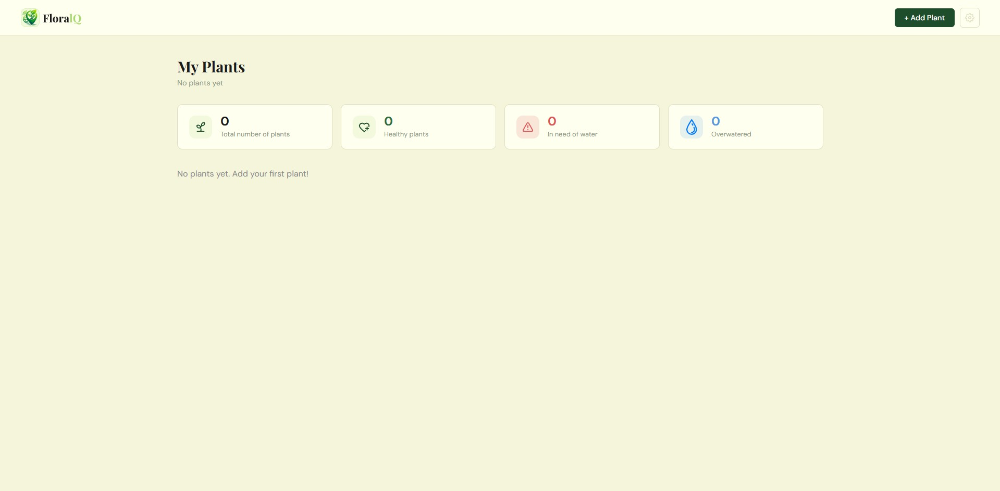   

---

## 6. Tutorial de onboarding   

Na primeira vez que aceder ao dashboard, aparece automaticamente um **tutorial interativo** que o guia pelos primeiros passos da plataforma.   

O tutorial cobre:   

1. Onde encontrar as definições.
2. Como resgatar um dispositivo.
3. Como adicionar a primeira planta.
4. Como interpretar os cards no dashboard.
5. Como aceder aos detalhes de uma planta.

Pode **saltar o tutorial** a qualquer momento clicando em **"Skip"**, ou **rever o tutorial mais tarde** através do menu Account -> Tutorial -> Replay.   

**Ecrã de referência:**   

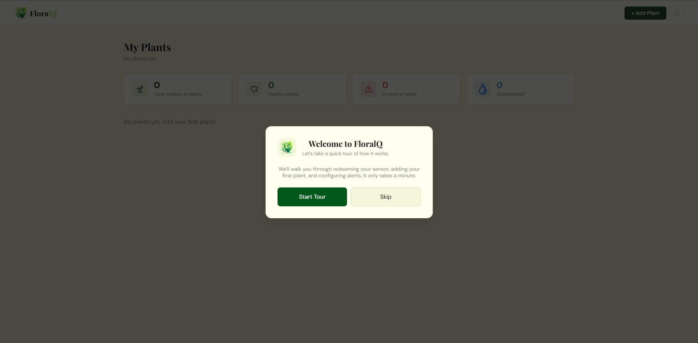

---

## 7. Resgatar um dispositivo   

Antes de criar uma planta, é necessário **associar um dispositivo FloralQ** à sua conta. Cada dispositivo vem com um **código de ativação** único.   

1. Clique no **ícone de engrenagem** no canto superior direito.
2. Selecione **"Redeem Device"** no menu.
3. Introduza o **código de ativação** (8 caracteres, ex: `9F9573B0`), o código é fornecido com o dispositivo.
4. Clique em **"Redeem"**.
5. O dispositivo passa a estar associado à sua conta e pode ser usado para criar uma planta.

**Ecrã de referência:**   

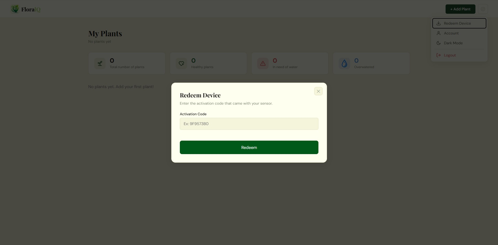

**Atenção:** Cada código de ativação só pode ser usado uma vez. Após o resgate, o código deixa de ser válido.   

---

## 8. Adicionar uma planta   

Para começar a monitorizar uma planta, é necessário associá-la a um dispositivo já resgatado.   

1. Clique em **"+ Add Plant"** no canto superior direito.
2. Preencha os campos:
   - **Plant Image (optional):** Escolha uma imagem da planta (JPG, PNG ou WEBP, máx. 5MB).
   - **Plant Name:** Nome à sua escolha (máx. 30 caracteres).
   - **Location:** Etiqueta de localização (ex: "Sala", "Cozinha", "Varanda") (máx. 50 caracteres).
   - **Plant Type:** Escolha a espécie da sua planta no dropdown.
   - **Device:** Escolha o dispositivo que vai monitorizar esta planta.
   - **Plant is already grown:** Marque se a planta já é adulta (afeta a mascote no ecrã do FloralQ Home).
3. Clique em **"Create Plant"**.
4. O card da planta passa a aparecer no dashboard.   

**Ecrã de referência:**   

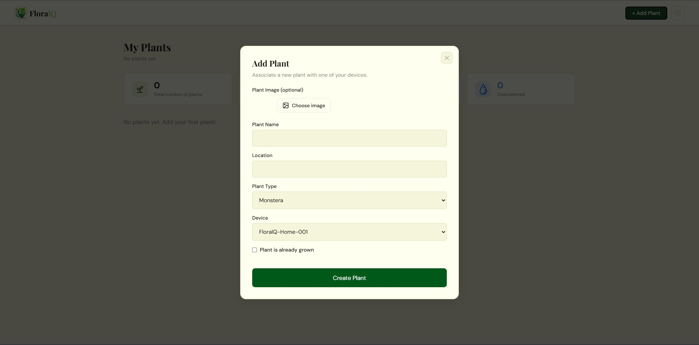   

**Nota:** O sensor faz leituras a cada 5 minutos, tenha isso em conta quando regar. Ao ligar, o sensor envia logo uma leitura, é boa prática ligar o dispositivo quando este já estiver na planta.   

---

## 9. Dashboard e cards de planta   

O dashboard apresenta uma **barra de estatísticas** no topo com quatro indicadores e os **cards das plantas** logo abaixo.   

### 9.1 Barra de estatísticas   

- **Total number of plants:** Número total de plantas registadas.
- **Healthy plants:** Plantas com humidade dentro do intervalo ideal.
- **In need of water:** Plantas com humidade abaixo do limiar mínimo.
- **Overwatered:** Plantas encharcadas.

### 9.2 Card de planta   

Cada card mostra:   

- **Gráfico circular**, humidade atual da planta (em percentagem relativa ao range da espécie).
- **Nome e imagem** da planta.
- **Badge de estado** (Healthy / Dry / Overwatered).
- **Previsão de secagem** (ex: "Runs dry in ~1h 40m").
- **Tempo desde a última leitura** (ex: "30s ago").
- **Gráfico de linhas*,* com o histórico de humidade nos últimos 24h, semana, mês ou ano.

**Ecrã de referência:**   

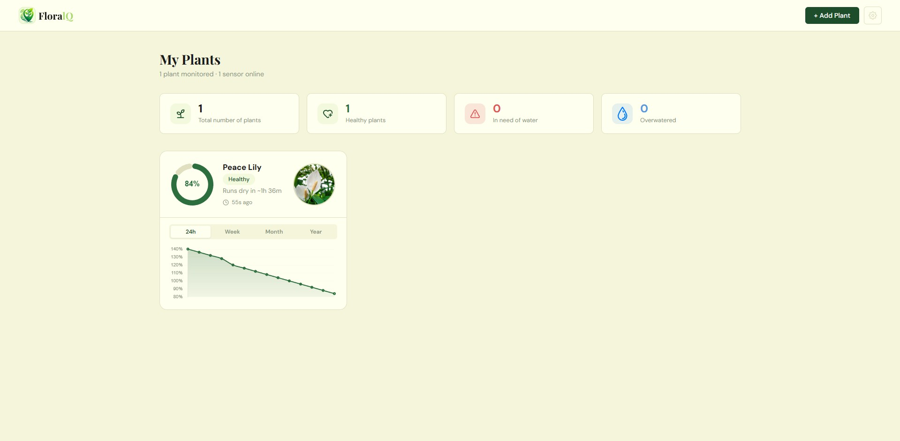   

---

## 10. Detalhes de uma planta   

Para ver informações detalhadas sobre uma planta, clique no respetivo card.   

Abre-se um modal com:   

- **Current moisture:** Humidade atual.
- **State:** Estado atual (Healthy / Dry / Overwatered).
- **Prediction:** Tipo de previsão (Drying, Recently Watered, Stable, etc.).
- **Dry at:** Data e hora estimada para a planta secar.
- **Min moisture:** Limiar mínimo de humidade da espécie.
- **Drying rate:** Taxa de secagem por hora.
- **Confidence:** Nível de confiança da previsão (Low / Medium / High).
- **Growth:** Estado de crescimento (Newborn / Grown).
- **Mapa GPS:** apenas para dispositivos **FloralQ Professional**.
- **Gráfico de histórico:** apenas se a posição do gráfico estiver definida como "Modal".

**Ecrã de referência (modo Card):**   

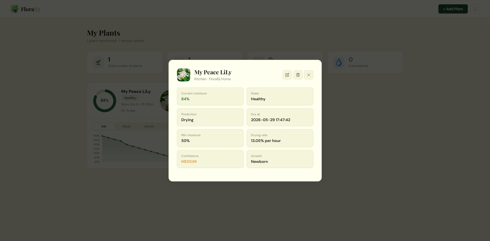   

**Ecrã de referência (modo Modal, com gráfico no modal):**   

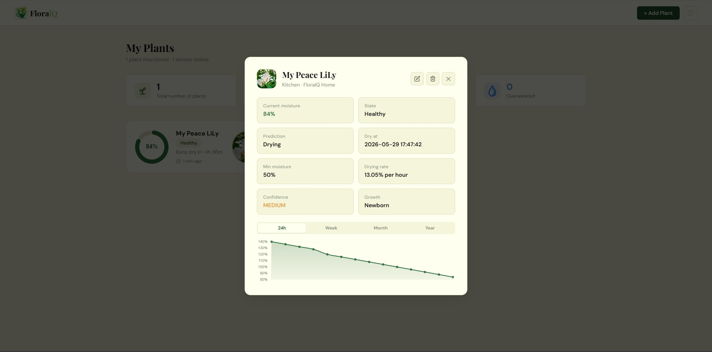   

---

## 11. Editar e remover plantas   

Dentro do modal de detalhes de uma planta, no canto superior direito, encontra dois botões:   

- **Ícone de lápis (Editar):** Abre o formulário pré-preenchido com os dados da planta. Pode alterar nome, localização, tipo, imagem ou estado de crescimento.
- **Ícone de caixote (Remover):** Abre uma confirmação para apagar a planta.

**Atenção:** Ao remover uma planta, todos os dados históricos de humidade e a imagem associada são **apagados permanentemente**. Esta ação é irreversível. O dispositivo associado fica livre para ser usado com outra planta.   

---

## 12. Conta e definições   

Para aceder às definições da conta:   

1. Clique no **ícone de engrenagem** no canto superior direito.
2. Selecione **"Account"**.

O modal de conta apresenta as seguintes secções:   

- **Email:** Visualização do email associado à conta e estado de verificação do mesmo.
- **Password:** Botão para alterar a palavra-passe.
- **Alerts:** Configuração do limiar de alerta de humidade e ativação de alertas por email.
- **Presentation Mode:** Escolha onde apresentar os gráficos de histórico (Card ou Modal).
- **Tutorial:** Botão para reproduzir novamente o tutorial de onboarding.

**Ecrã de referência:**   

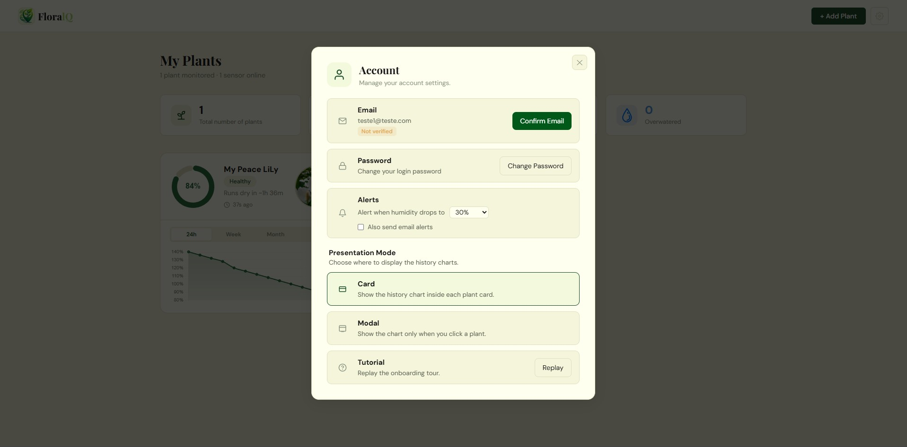

### 12.1 Configurar alertas   

Na secção **Alerts**, pode:   

1. Escolher o **limiar de humidade** abaixo do qual deve receber um alerta (5%, 10%, 15%, 20%, 25%, 30%, 40% ou 50%).
2. Marcar **"Also send email alerts"** para receber também alertas por email.

As alterações são guardadas automaticamente.   

### 12.2 Alterar palavra-passe   

1. No modal **Account**, clique em **"Change Password"** na secção Password.
2. Preencha:
   - **Current Password:** A sua palavra-passe atual.
   - **New Password:** Nova palavra-passe (mínimo 6 caracteres).
   - **Repeat New Password:** Confirmação da nova palavra-passe.
3. Clique em **"Save Password"**.   

A nova palavra-passe é aplicada imediatamente.   

### 12.3 Modo de apresentação   

A FloralQ permite escolher onde apresentar os gráficos de histórico de humidade:   

- **Card (predefinido)**: O gráfico de linhas aparece dentro de cada card no dashboard.
- **Modal:** O gráfico aparece apenas quando clica num card para abrir os detalhes.

Para alterar:   

1. Abra **Account** no menu de definições.
2. Na secção **Presentation Mode**, clique na opção desejada.
3. O dashboard recarrega automaticamente com a nova configuração.

---

## 13. Terminar sessão

1. Clique no **ícone de engrenagem** no canto superior direito.
2. Selecione **"Logout"** (em vermelho, no fim do menu).

Será redirecionado para a página de login.

**Ecrã de referência (menu de definições):**
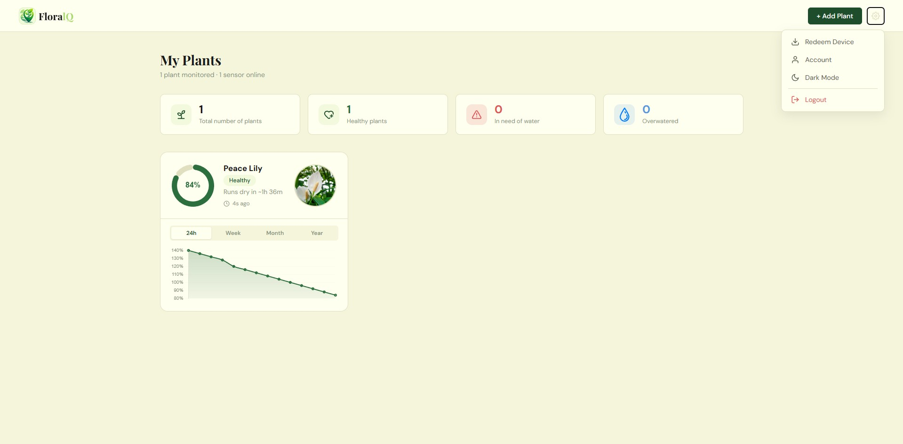

---

## 14. Boas práticas

- **Imagens das plantas:** Adicione uma fotografia para facilitar a identificação visual no dashboard. 
- **Tipo de planta:** Escolha o tipo correto, define os limiares de humidade ideais e afeta a precisão dos alertas.
- **Limiar de alerta:** Valores entre 25% e 30% são adequados para a maioria das plantas.
- **Confiança da previsão:** previsões com confiança **High** são as mais fiáveis. Previsões **Low** podem indicar dados ainda insuficientes, aguarde mais algumas horas de leituras.
- **Ativação de Dispositivo:** Antes de ligar o seu disposiivo insira-o na sua planta para a primeira leitura ser válida, o dispositvo envia imediatamente uma leitura ao ligar.

---

## 15. Resolução de problemas

**O card da planta não mostra dados de humidade**
- Confirme que o dispositivo está ligado e à rede WiFi.
- O sensor faz leituras a cada 5 minutos, aguarde alguns minutos após adicionar a planta.
- Se aparecer "Sensor Offline" no card, verifique a ligação do dispositivo.

**Não consigo resgatar o dispositivo**
- Confirme que está a inserir o código exatamente como aparece (sem espaços).
- Cada código só pode ser usado uma vez. Se o código já foi usado, contacte o suporte.

**Não consigo criar conta**
- Verifique se o email já está registado.
- A palavra-passe tem de ter no mínimo 6 caracteres.
- Verifique se as duas palavras-passe coincidem.

**Não consigo iniciar sessão**
- Confirme que está a usar o email correto.
- Verifique maiúsculas/minúsculas na palavra-passe.
- Se esqueceu a palavra-passe, clique em "Forgot Password?".

**A previsão mostra "Not enough data"**
- É necessário pelo menos 3 leituras válidas para gerar uma previsão.
- Aguarde alguns minutos para acumular dados suficientes.

**O mapa GPS não aparece no modal de detalhes**
- O mapa só está disponível para dispositivos do tipo **FloralQ Professional**.
- O dispositivo precisa de ter pelo menos uma leitura GPS válida (com sinal).
- Para obter uma leitura GPS, garanta que o sensor tem uma vista desimpedida do céu.

**Os alertas não chegam por email**
- Confirme que ativou a opção "Also send email alerts" em Account -> Alerts.
- Confirme que o email da conta é o seu.
