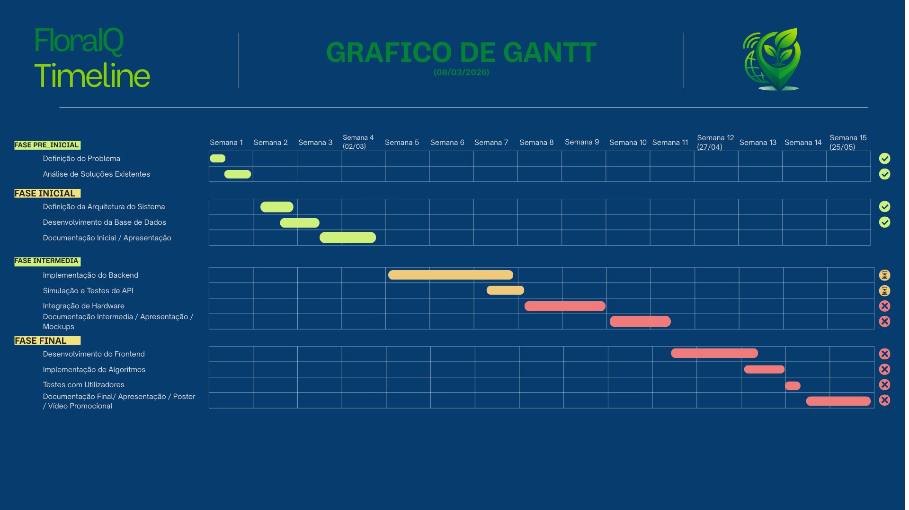

# FloralQ – Plataforma de Monitorização de Plantas

**Universidade Europeia / IADE – Engenharia Informática**  
**Projeto de Desenvolvimento Web – 4º Semestre (2025/2026)**  
**Autor**: Pedro António  

**GitHub**: [Repositorio GitHub](https://github.com/MelhorNarrador/ProjetoWeb_Pedro)

---

---

## Palavras-chave
IoT, sensores ambientais, monitorização de plantas, geolocalização, dashboard web, agricultura urbana, planeamento urbano

---

## 1. Introdução

Este relatório apresenta a proposta inicial do projeto **FloralQ**, desenvolvido no âmbito da unidade curricular de Projeto de Desenvolvimento Web do 4.º semestre da Licenciatura em Engenharia Informática.

A **FloralQ** é uma plataforma web de monitorização de plantas que combina **sensores IoT** (humidade do solo e GPS) com uma **aplicação web**, permitindo aos utilizadores acompanhar o estado das suas plantas em tempo real, prever necessidades de rega e geolocalizar plantas em jardins ou espaços urbanos.

Esta primeira fase do projeto centra-se na **pesquisa e definição do conceito**: análise do problema, estudo do mercado, identificação do público-alvo, definição de requisitos e planeamento das tarefas a desenvolver ao longo do semestre.

---

## 2. Metodologia
O projeto está estruturado em **Quatro fases**, cada uma com entregáveis específicos:

- **Fase 1 - Pesquisa pre-inicial** (1 semana): definição do conceito, análise de mercado, público-alvo e pre planeamento.
- **Fase 2 - Conceitualização** (3 semanas): definição da arquitetura, desenvolvimento da base de dados(1.0), documentação e proposta da idea.
- **Fase 3 - Implementação** (7 semanas): implementação do backend, testes de API, algoritmo predictivo, implementação de Iot, mockups, design system, documentação intermedia e protótipo funcional.
- **Fase 4 - Polimento** (3 semanas): implementação da UI final, backoffice, testes de usabilidade, refatoração de código e documentação final.

Este relatório corresponde aos entregáveis da Fase 1.

---

## 3. Descrição e Problema
O cuidado de plantas e espaços verdes é frequentemente baseado em observação manual e experiência empírica.  
Muitas pessoas têm dificuldade em perceber **quando regar uma planta**, o que pode levar a problemas como excesso ou falta de água.
Além disso, a monitorização de plantas em jardins ou espaços urbanos não é normalmente acompanhada por dados objetivos em tempo real.

A **FloralQ** pretende resolver este problema através de uma plataforma que combina **sensores físicos de humidade do solo e localização GPS** com uma **aplicação web**, permitindo monitorizar o estado das plantas e analisar dados ao longo do tempo.

---

# 4. Objetivos & Motivação

## 4.1 Objetivos

- Desenvolver uma aplicação web para monitorização de plantas.
- Integrar sensores IoT para recolha de dados.
- Guardar e analisar leituras de humidade do solo.
- Apresentar dados num dashboard visual.
- Mostrar a localização da planta num mapa interativo.
- Permitir a gestão de múltiplas plantas por utilizador.

## 4.2 Motivação

Mesmo com o crescimento de **espaços verdes urbanos** e com o geral interesse por plantas domésticas, prova-se dificil encontrar uma plataforma que disponha de ferramentas tecnológicas que ajudem na manutenção correta de plantas de forma acessível.

O FloralQ pretende tornar a monitorização **mais precisa, automatizada e acessível**, combinando hardware simples com uma interface web intuitiva.

---

# 5. Público-alvo

A FloralQ dirige-se a três perfis distintos, com necessidades e contextos de utilização diferentes.

**Utilizadores Domésticos**
- **Perfil demográfico:** todas as idades, estudantes ou profissionais, residentes em apartamentos ou moradias com plantas.
- **Hábitos e comportamentos:** Compram plantas por estética e bem-estar, mas têm pouco conhecimento técnico sobre cuidados. Utilizam smartphone diariamente e estão confortáveis com apps web.
- **Necessidade principal:** Saber quando regar sem ter de verificar manualmente todos os dias.
- **Frustração atual:** Plantas que morrem por excesso ou falta de água, sem perceber porquê.

**Jardins Privados e Hortas Domésticas**
- **Perfil demográfico:** todas as idades, proprietários de jardins ou pequenas hortas.
- **Hábitos e comportamentos:** Gerem múltiplas plantas de espécies diferentes, com necessidades de rega distintas. Preferem soluções práticas a aplicações complexas. Valorizam dados históricos para perceber padrões sazonais.
- **Necessidade principal:** Gestão centralizada de múltiplas plantas com alertas.
- **Frustração atual:** Impossibilidade de monitorizar todas as plantas ao mesmo tempo, especialmente em jardins maiores.

**Gestores de Espaços Verdes Urbanos**
- **Perfil demográfico:** 30-50 anos, técnicos de jardinagem ou gestores municipais responsáveis por parques e jardins urbanos.
- **Hábitos e comportamentos:** Gerem dezenas de plantas. Precisam de relatórios e dados estatísticos para justificar decisões de manutenção. Trabalham com sistemas de informação geográfica.
- **Necessidade principal:** Visualização da localização e estado de todas as plantas num mapa.
- **Frustração atual:** Ausência de ferramentas acessíveis que integrem IoT com SIG.

---

# 6. Pesquisa de Mercado

| Plataforma | Tipo | Pontos Fortes | Pontos Fracos | Oportunidade para FloralQ |
|---|---|---|---|---|
| **Planta App** | App móvel | Interface intuitiva  Recomendações personalizadas   Identificação de espécies por imagem | Não utiliza sensores físicos   Baseia-se exclusivamente em inputs manuais do utilizador   Sem dados objetivos | Integração de sensores reais com dados automáticos, sem depender de input manual |
| **Weenat** | Plataforma agro | Monitorização com sensores reais   Dados ambientais detalhados (temperatura, humidade, chuva) | Foco exclusivo na agricultura profissional   sistema complexo e caro   interface pouco acessível ao utilizador comum | Solução mais simples, acessível e orientada ao utilizador doméstico e urbano |
| **Greg App** | App móvel | Lembretes de rega baseados em espécie e localização | Sem sensores   Baseado em calendário fixo, não em dados reais do solo | Dados reais do sensor substituem suposições baseadas em calendário | 

A FloralQ diferencia-se por ser a única solução que combina, num produto acessível ao utilizador comum:

1. **Sensores físicos de humidade** com leituras automáticas a cada 5 minutos.
2. **Algoritmo preditivo** que estima quando a planta vai precisar de água (não apenas alerta quando já está seca).
3. **Geolocalização GPS** para plantas em jardins ou espaços urbanos.
4. **Interface web responsiva** com dashboard visual, sem necessidade de app móvel (Possivel implementação futura).
5. **Mascote animada** no ecrã do dispositivo, que torna a interação intuitiva mesmo sem aceder ao dashboard.

---

# 5. Guiões de Teste

### Guião 1 – Registar uma planta

1. O utilizador cria uma conta na plataforma.  
2. Regista uma nova planta no sistema.  
3. Associa um dispositivo sensor à planta.  
4. O dispositivo envia leituras de humidade para o servidor.  
5. O dashboard apresenta os dados da planta.

**Resultado esperado**: O utilizador consegue registar uma planta.

---

### Guião 2 – Monitorizar uma planta

1. O utilizador acede ao dashboard.  
2. Seleciona uma planta registada.  
3. Visualiza a humidade do solo e verifica.  
4. Consulta a localização da planta no mapa.

**Resultado esperado**: O utilizador compreende facilmente o estado da planta.

---

### Guião 3 – Receber nova leitura do sensor

1. O dispositivo ESP32 mede a humidade do solo.  
2. Envia os dados para a API do servidor.  
3. O servidor guarda a leitura na base de dados.  
4. O dashboard apresenta a nova leitura.

**Resultado esperado**: O sistema atualiza automaticamente os dados.

---

# 6. Descrição da Solução

## 6.1 Enquadramento nas UCs

### Sistemas de Informação Geográficos
A aplicação inclui integração com sistemas de informação geográfica para visualizar a localização das plantas num mapa.  
Os dados de latitude e longitude recolhidos pelo sensor GPS são apresentados numa interface com mapa interativo, permitindo localizar cada planta e visualizar as leituras associadas.

### Programação Web
A lógica principal da aplicação é desenvolvida em **PHP**, responsável por:
- gerir utilizadores e autenticação,
- receber dados enviados pelo dispositivo IoT,
- armazenar leituras na base de dados,
- disponibilizar dados através de endpoints para o dashboard.

### Interfaces e Usabilidade
A interface web do sistema é desenvolvida com **HTML, CSS e JavaScript**, com foco numa experiência de utilização simples e intuitiva.  
O dashboard apresenta informação relevante de forma clara.

### Estatística
Os dados recolhidos pelos sensores permitem realizar análises simples, como:
- média de humidade do solo,
- evolução temporal das leituras,
- comparação com valores ideais definidos para cada tipo de planta.

Estas análises permitem interpretar o estado da planta ao longo do tempo.

### Algoritmos e Estrutura de Dados
O sistema inclui lógica de processamento de dados para interpretar as leituras dos sensores.  
A partir das leituras de humidade, podem ser aplicados algoritmos simples para detetar padrões ou prever situações de secura, auxiliando na manutenção das plantas.

### Projeto de Desenvolvimento Web
Esta unidade curricular estrutura o desenvolvimento global do projeto, incluindo:
- planeamento do sistema,
- definição da arquitetura da aplicação,
- integração entre hardware, backend e interface web,
- documentação e organização do trabalho.

---

## 6.2 Requisitos

### Requisitos Funcionais

- Registo e autenticação de utilizadores  
- Criação e gestão de múltiplas plantas 
- Associação de dispositivos a plantas  
- Receção de dados enviados por sensores IoT  
- Visualização de leituras de humidade  
- Visualização da localização da planta em mapa
- Algoritmos preditivos

### Requisitos Não Funcionais

- Reconhecimento de doenças por imagem (Plant.id API)
- Alertas por email

---

## 6.3 Arquitetura

A arquitetura do sistema segue um modelo simples de três camadas:

**Dispositivo IoT**
- ESP32  
- Sensor de humidade do solo  
- Módulo GPS  

↓

**Servidor Backend**
- API em PHP responsável por receber e processar dados  

↓

**Base de Dados**
- PostgreSQL para armazenamento de utilizadores, plantas e leituras  

↓

**Dashboard Web**
- Interface desenvolvida em HTML, CSS e JavaScript  
- Visualização de dados e mapas interativos  

Esta arquitetura permite separar claramente as responsabilidades entre recolha de dados, processamento e visualização.

---

## 6.4 Tecnologias a Utilizar

### Backend
- PHP   

### Base de Dados
- PostgreSQL  

### Frontend
- HTML  
- CSS  
- JavaScript  

### Hardware IoT
- ESP32  
- Sensor de humidade do solo  
- Módulo GPS  

### Ferramentas de Desenvolvimento
- VSCode  
- GitHub  
- Postman  
- pgAdmin4

---

# 7. Planeamento

## Grafico de Gantt (08/03/2026)

---

# 8. Conclusão

A **FloralQ** pretende demonstrar como a integração de **tecnologias IoT com aplicações web** pode facilitar a monitorização de plantas e melhorar a sua manutenção.

A combinação de sensores físicos com um dashboard web permitirá aos utilizadores acompanhar o estado das suas plantas de forma simples e informada.

Nas fases seguintes do projeto será desenvolvido um **protótipo funcional**, se possível, incluindo a integração dos dispositivos IoT com o backend da aplicação.
