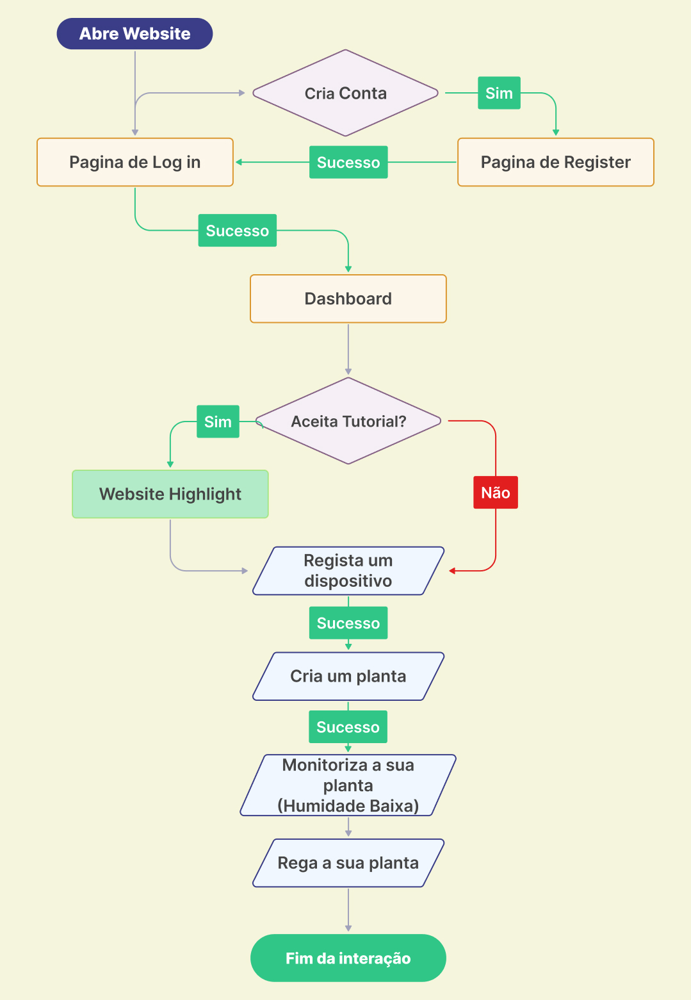
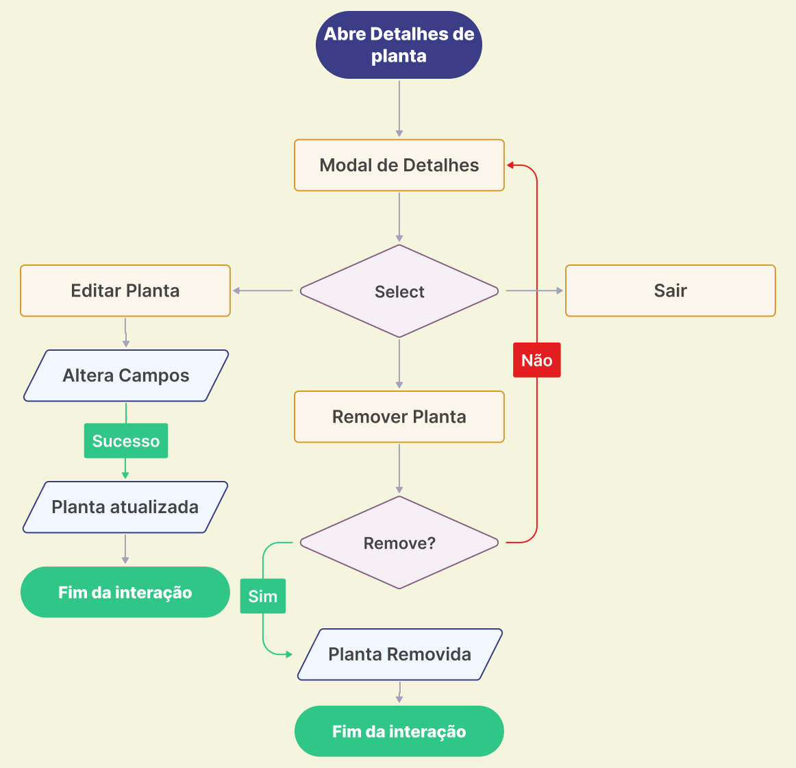
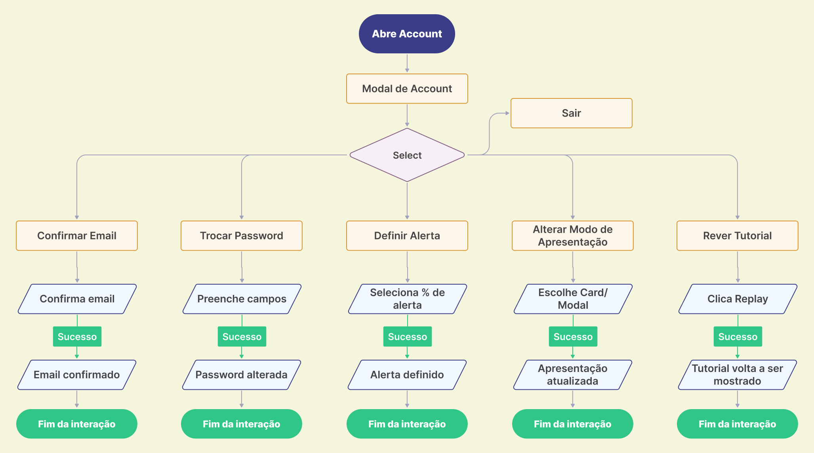
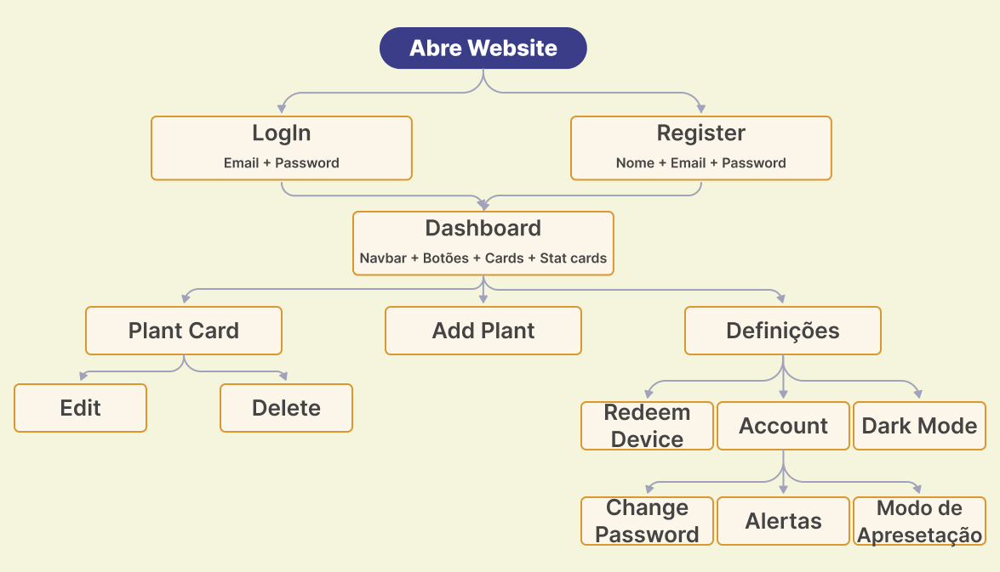
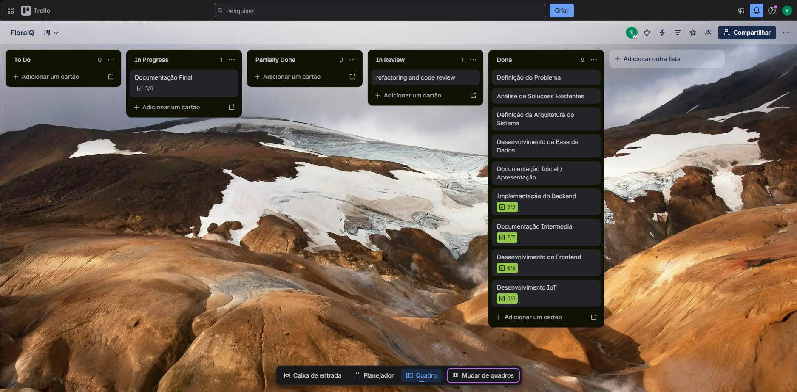

# FloralQ - Plataforma de Monitorização de Plantas

**Universidade Europeia / IADE**
**Licenciatura em Engenharia Informática - Projeto de Desenvolvimento Web - 4.º Semestre (2025/2026)**  
**Autor:** Pedro António - N.º 20241273  
**Relatório em .md** [L0: Relatório .md](https://github.com/MelhorNarrador/ProjetoWeb_Pedro/blob/28830ebeaeb4d51cfa95d8d259b0206d506aa8e8/Documentos/Relat%C3%B3rio_v3.md)  
**GitHub**: [L1: Repositorio GitHub](https://github.com/MelhorNarrador/ProjetoWeb_Pedro)  

---

## Palavras-chave

IoT, sensores ambientais, monitorização de plantas, geolocalização, dashboard web, agricultura urbana, regressão linear, algoritmo preditivo, PHP, PostgreSQL, ESP32

---

## Índice

1. [Introdução](#1-introdução)
2. [Enquadramento e Problema](#2-enquadramento-e-problema)
3. [Objetivos e Motivação](#3-objetivos-e-motivação)
4. [Pesquisa de Mercado e Análise Competitiva](#4-pesquisa-de-mercado-e-análise-competitiva)
5. [Público-Alvo e User Research](#5-público-alvo-e-user-research)
6. [Casos de Uso e Modelo de Domínio](#6-casos-de-uso-e-modelo-de-domínio)
7. [Arquitetura e Tecnologias](#7-arquitetura-e-tecnologias)
8. [Base de Dados](#8-base-de-dados)
9. [Documentação da API REST](#9-documentação-da-api-rest)
10. [Algoritmo Preditivo de Secagem e Análise Estatística](#10-algoritmo-preditivo-de-secagem-e-análise-estatística)
11. [Dispositivos FloralQ Home e Professional](#11-dispositivos-floralq-home-e-professional)
12. [Hardware IoT - ESP32](#12-hardware-iot---esp32)
13. [UI/UX Design System e Interfaces](#13-uiux-design-system-e-interfaces)
14. [User Task Flow e Diagrama de Informação](#14-user-task-flow-e-diagrama-de-informação)
15. [Backoffice de Administração](#15-backoffice-de-administração)
16. [Dashboard](#16-dashboard)
17. [Testes de Usabilidade](#17-testes-de-usabilidade)
18. [Planeamento e Execução](#18-planeamento-e-execução)
19. [Contribuição por Unidade Curricular](#19-contribuição-por-unidade-curricular)
20. [Conclusão](#20-conclusão)
21. [Links](#21-links)

---

## 1. Introdução

Este relatório documenta o desenvolvimento completo da **FloralQ**, uma plataforma web de monitorização de plantas desenvolvida no âmbito da unidade curricular de Projeto de Desenvolvimento Web do 4.º semestre da Licenciatura em Engenharia Informática da Universidade Europeia / IADE.

O projeto foi desenvolvido segundo a metodologia **Project-Based Learning (PBL)**, integrando as cinco unidades curriculares do semestre: Projeto de Desenvolvimento Web, Programação Web, Interfaces e Usabilidade, Estatística e Sistemas de Informação Geográficos, Algoritmos e Estruturas de Dados.

O desenvolvimento decorreu ao longo de **14 semanas**, organizado em quatro fases:
- **Fase 1 - Pesquisa pre-inicial** (1 semana): definição do conceito, análise de mercado, público-alvo e pre planeamento.
- **Fase 2 - Conceitualização** (3 semanas): definição da arquitetura, desenvolvimento da base de dados(1.0), documentação e proposta da idea.
- **Fase 3 - Implementação** (7 semanas): implementação do backend, testes de API, algoritmo predictivo, implementação de Iot, mockups, design system, documentação intermedia e protótipo funcional.
- **Fase 4 - Polimento** (3 semanas): implementação da UI final, backoffice, testes de usabilidade, refatoração de código e documentação final.
Este documento agrega e atualiza os conteúdos das entregas anteriores, incorporando as melhorias sugeridas pela docente, e apresenta o estado final da solução  

---

## 2. Enquadramento e Problema

### 2.1 Contexto

O cuidado de plantas e espaços verdes é frequentemente baseado em **observação manual** e **experiência empírica**. A ausência de dados objetivos sobre o estado do solo leva a dois problemas recorrentes: o excesso de rega, que apodrece as raízes, e a falta de rega, que resseca a planta. Nenhum dos dois é imediatamente visível a olho nu antes de o dano estar feito.

Paralelamente, o crescimento dos **espaços verdes urbanos** e a popularização das plantas domésticas, criou uma nova geração de utilizadores que valoriza a manutenção de plantas mas não dispõe de experiência acumulada ou de ferramentas tecnológicas acessíveis para o fazer corretamente.

### 2.2 Problema

O problema central que a FloralQ procura resolver é a **falta de informação objetiva e em tempo real** sobre o estado das plantas. Mais especificamente:

- Os utilizadores domésticos não sabem **quando regar** nem **quanto regar**.
- Os gestores de espaços verdes urbanos e privados não têm uma plataforma acessível que centralize dados de múltiplas plantas e forneça alertas automáticos.
- As soluções existentes são ou demasiado complexas e caras (destinadas à agricultura profissional) ou demasiado simplistas (sem sensores físicos ou baseadas apenas em inputs manuais).  

### 2.3 Solução Proposta

A **FloralQ** resolve este problema através de uma plataforma que combina **sensores físicos IoT** (humidade do solo + GPS) com uma **aplicação web**, permitindo:

- Monitorizar o estado das plantas em tempo real, com dados objetivos.
- Prever automaticamente quando a planta vai precisar de água, através de um algoritmo de regressão linear.
- Geolocalizar as plantas em jardins ou espaços urbanos.
- Gerir múltiplas plantas por utilizador, com histórico de leituras e alertas configuráveis.
- Apresentar uma mascote animada no ecrã do dispositivo IoT que reflete visualmente o estado da planta (estilo Tamagotchi).

---

## 3. Objetivos e Motivação

### 3.1 Objetivos

- Desenvolver uma aplicação web completa para monitorização de plantas, com backend PHP, base de dados PostgreSQL e frontend HTML/CSS/JS.
- Integrar sensores IoT (ESP32 com sensor de humidade, módulo GPS e ecrã LCD) com o backend via API REST.
- Implementar um algoritmo preditivo de secagem baseado em regressão linear com filtragem de outliers para integridade de dados.
- Apresentar dados num dashboard visual com gráficos de humidade e mapas de localização.
- Produzir um dashboard estatístico dinâmico a partir dos dados da base de dados.
- Garantir uma interface intuitiva, validada por testes de usabilidade com utilizadores reais.
- Integrar um sistema de informação geográfica para localização das plantas.

### 3.2 Motivação

Mesmo com o crescimento dos espaços verdes urbanos e o interesse generalizado por plantas domésticas, continua a ser difícil encontrar uma plataforma que disponibilize ferramentas tecnológicas acessíveis para a manutenção correta de plantas. A FloralQ pretende preencher esse espaço, tornando a monitorização mais **precisa, automatizada e acessível**, combinando hardware simples com uma interface web intuitiva.

---

## 4. Pesquisa de Mercado e Análise Competitiva

Para fundamentar o posicionamento da FloralQ, foram analisadas as principais soluções existentes no mercado, avaliando os seus pontos fortes, pontos fracos e a oportunidade que cada um deixa em aberto.

### 4.1 Tabela Comparativa

| Plataforma | Tipo | Pontos Fortes | Pontos Fracos | Oportunidade para FloralQ |
|---|---|---|---|---|
| **Planta App** | App móvel | Interface intuitiva  Recomendações personalizadas   Identificação de espécies por imagem | Não utiliza sensores físicos   Baseia-se exclusivamente em inputs manuais do utilizador   Sem dados objetivos | Integração de sensores reais com dados automáticos, sem depender de input manual |
| **Weenat** | Plataforma agro | Monitorização com sensores reais   Dados ambientais detalhados (temperatura, humidade, chuva) | Foco exclusivo na agricultura profissional   sistema complexo e caro   interface pouco acessível ao utilizador comum | Solução mais simples, acessível e orientada ao utilizador doméstico e urbano |
| **Greg App** | App móvel | Lembretes de rega baseados em espécie e localização | Sem sensores   Baseado em calendário fixo, não em dados reais do solo | Dados reais do sensor substituem suposições baseadas em calendário |

### 4.2 Posicionamento da FloralQ

A FloralQ diferencia-se por ser a única solução que combina, num produto acessível ao utilizador comum:

1. **Sensores físicos de humidade** com leituras automáticas a cada 5 minutos.
2. **Algoritmo preditivo** que estima quando a planta vai precisar de água (não apenas alerta quando já está seca).
3. **Geolocalização GPS** para plantas em jardins ou espaços urbanos.
4. **Interface web responsiva** com dashboard visual, sem necessidade de app móvel (Possivel implementação futura).
5. **Mascote animada** no ecrã do dispositivo, que torna a interação intuitiva mesmo sem aceder ao dashboard.

---

## 5. Público-Alvo e User Research

### 5.1 Segmentos de Utilizadores

A FloralQ dirige-se a três perfis distintos, com necessidades e contextos de utilização diferentes.

**Utilizadores Domésticos**
- **Perfil demográfico:** todas as idades, estudantes ou profissionais, residentes em apartamentos ou moradias com plantas.
- **Hábitos e comportamentos:** Compram plantas por estética e bem-estar, mas têm pouco conhecimento técnico sobre cuidados. Utilizam smartphone diariamente e estão confortáveis com apps web.
- **Necessidade principal:** Saber quando regar sem ter de verificar manualmente todos os dias.
- **Frustração atual:** Plantas que morrem por excesso ou falta de água, sem perceber porquê.

**Jardins Privados e Hortas Domésticas**
- **Perfil demográfico:** todas as idades, proprietários de jardins ou pequenas hortas.
- **Hábitos e comportamentos:** Gerem múltiplas plantas de espécies diferentes, com necessidades de rega distintas. Preferem soluções práticas a aplicações complexas. Valorizam dados históricos para perceber padrões sazonais.
- **Necessidade principal:** Gestão centralizada de múltiplas plantas com alertas.
- **Frustração atual:** Impossibilidade de monitorizar todas as plantas ao mesmo tempo, especialmente em jardins maiores.

**estores de Espaços Verdes Urbanos**
- **Perfil demográfico:** 30-50 anos, técnicos de jardinagem ou gestores municipais responsáveis por parques e jardins urbanos.
- **Hábitos e comportamentos:** Gerem dezenas de plantas. Precisam de relatórios e dados estatísticos para justificar decisões de manutenção. Trabalham com sistemas de informação geográfica.
- **Necessidade principal:** Visualização da localização e estado de todas as plantas num mapa.
- **Frustração atual:** Ausência de ferramentas acessíveis que integrem IoT com SIG.

### 5.2 Personas e User Journey

As personas e a user journey foram desenvolvidas com base numa investigação UI/UX que foi feita através de entrevistas a 3 participantes selecionados por conveniência(representantes do público alvo). As entrevistas recolheram dados sobre hábitos, motivações, frustrações e expectativas.  

[L2: Ver UX Case Study completo](https://github.com/MelhorNarrador/ProjetoWeb_Pedro/blob/1770febdf1bf600f499eba23e7a905e824d92ba5/Documentos/UI_Assets_%26_Design_System/FloralQ-User-Research.pdf)

---

## 6. Casos de Uso e Modelo de Domínio

### 6.1 Atores do Sistema

O sistema da FloralQ tem cinco atores principais:

- **Utilizador Anónimo:** Pode aceder à página de login, registar-se e criar uma conta.
- **Utilizador Registado:** Pode gerir plantas, associar dispositivos, consultar o dashboard, configurar alertas, alterar palavra-passe e customizar modo de apresentação.
- **Utilizador Registado com Dispositivo Profissional:** Tem acesso adicional à localização GPS da planta no mapa.
- **Administrador:** Gere utilizadores, dispositivos e plantas através do backoffice; tem acesso ao dashboard estatístico.
- **Sistema:** É responsável por emitir alertas automáticos (in-app e email) quando os limiares de humidade são ultrapassados.
- **Dispositivo IoT (ESP32):** Ator externo que envia leituras de humidade e GPS via API REST, sem autenticação de sessão.  

### 6.2 Modelo de Domínio  
  

O modelo de domínio representa cinco entidades centrais e as suas relações:

- **User_Account:** Representa um utilizador registado. Tem um papel (user/admin), email, password hash, configurações de alerta e preferências de dashboard.
- **Device:** Representa um sensor ESP32. Pertence a um User_Account (após resgate) e pode ser do tipo Home ou Professional (com GPS). Tem um código de ativação único usado no registo inicial(Depois de uso -> NULL).
- **Plant:** Representa uma planta monitorizada. Pertence a um User_Account, está associada a um Device e tem um Plant_Type. Pode ter uma imagem.
- **Plant_Type:** Catálogo de espécies com limiares de humidade mínimo e máximo.
- **Sensor_Reading:** Cada leitura enviada pelo sensor. Contém percentagem de humidade, coordenadas GPS (opcionais) e timestamp. Está associada ao Device que a gerou.

---

## 7. Arquitetura e Tecnologias

### 7.1 Arquitetura do Sistema

A arquitetura da FloralQ segue um modelo **Cliente-Servidor em quatro camadas**, com comunicação HTTP entre todas as camadas:

**Dispositivo IoT**
- ESP32 + Sensor de humidade + Módulo GPS (Professional) + Ecrã LCD (Home)
- Comunicação com o backend via HTTP POST (JSON) a cada 5 minutos
  
**Backend**
- PHP + Apache (XAMPP, necessario para SSE(Workers))
- API REST com endpoints de autenticação, CRUD, IoT e administração
- Sessões PHP
- Cookie protegido com `HttpOnly = True`, `SameSite = Strict`, `Lifetime = 0`
- PDO com prepared statements em todos os endpoints para prevenção de SQL Injection
- Operações destrutivas usam transações PDO para garantir integridade de dados
- Endpoints privados protegidos por `RequireAuth` e `RequireAdmin` para endpoints de administrador
- Server-Sent Events (SSE) para atualizações em tempo real no dashboard
- Password com Hash Bcrypt  

**Base de Dados**
- PostgreSQL com 5 tabelas
- Acesso via PDO com prepared statements para prevenção de SQL Injection
- Índice `idx_sensor_device_time` para otimização de queries temporais

**Frontend Web**
- HTML + CSS + JavaScript, sem frameworks
- Gráficos: Chart.js (doughnut + linha)
- Mapas: Google Maps iframe
- Onboarding: Driver.js
- Autenticação via sessão PHP server-side

### 7.2 Padrões e Decisões de Arquitetura

- **API REST sem estado (stateless exceto para sessão PHP):** Cada endpoint tem responsabilidade única, retorna sempre JSON.
- **Separação de endpoints IoT e web:** Os endpoints IoT (`insert_reading.php`, `register_device.php`, `get_plant_state.php`) não requerem sessão PHP e validam apenas pelo `device_code` do dispositivo. Os endpoints web requerem sessão via `requireAuth()`.
- **Server-Sent Events (SSE):** O dashboard usa `sse_plants.php` e o backoffice usa `sse_admin.php`, ambos verificando periodicamente alterações na base de dados e emitindo eventos sem necessidade de polling do frontend.
- **Prepared statements PDO:** Em todos os acessos à base de dados, prevenindo SQL Injection.
- **Bcrypt:** Para hash de passwords, com `password_hash()` / `password_verify()`.
- **JS modular:** No frontend, com separação de responsabilidades: `apiClient.js`, `chartController.js`, `plantCard.js`, `modalManager.js`, `onboarding.js`, `toast.js`.

### 7.3 Stack Tecnológica

| Camada | Tecnologia | Justificação |
|---|---|---|
| Backend | PHP | Requisito do briefing, XAMPP necessário para suporte a SSE com Workers |
| Base de Dados | PostgreSQL | Suporte a `SERIAL`, `TIMESTAMPTZ`, `DECIMAL`, `ON CONFLICT DO UPDATE`. Melhor para dados temporais |
| Frontend | HTML + CSS + JavaScript | Sem framework, Requisito do briefing |
| Gráficos | Chart.js | Suporta doughnut e line |
| Mapas | Google Maps iframe | Integração via iframe com coordenadas GPS, não requer API key |
| Onboarding | Driver.js | Tour interativo passo a passo |
| IoT | ESP32 (Arduino IDE) | Microcontrolador com WiFi integrado |
| Sensor | Sensor de humidade | Necessario para medir humidade do solo |
| GPS | Módulo GPS, TinyGPSPlus | Necessario para obter localização GPS |
| Ecrã | LCD 1.69", TFT_eSPI | Display colorido para a mascote animada |
| Ferramentas | VSCode, pgAdmin4, Postman, GitHub, Figma | Ferramentas standard de desenvolvimento |

---

## 8. Base de Dados

### 8.1 Diagrama Entidade-Relação (descrição)

A base de dados PostgreSQL é composta por cinco tabelas  
[L3: Schema SQL](https://github.com/MelhorNarrador/ProjetoWeb_Pedro/blob/0104390cbb20322ac16dbacf3ea70c417e20a12e/Sql/Create2.0.sql)  

### 8.2 Dicionário de Dados  

#### Tabela user_account
| Campo | Tipo | Constraints | Descrição |
|---|---|---|---|
| `user_account_id` | SERIAL | PRIMARY KEY | Identificador único do utilizador |
| `user_account_name` | VARCHAR(100) | NOT NULL | Nome de utilizador |
| `user_account_email` | VARCHAR(255) | UNIQUE NOT NULL | Email de login |
| `user_account_password_hash` | TEXT | NOT NULL | Hash da password |
| `user_account_role` | VARCHAR(20) | CHECK IN ('user','admin') | Papel no sistema |
| `user_account_email_verified` | BOOLEAN | DEFAULT FALSE | Flag de email confirmado |
| `user_account_alert_threshold` | INT | DEFAULT 30 | Limiar de alerta (%) configurado |
| `user_account_alert_email_enabled` | BOOLEAN | DEFAULT FALSE | Ativa alertas por email |
| `user_account_chart_position` | VARCHAR(10) | CHECK IN ('card','modal') | Posição do gráfico de histórico |
| `user_created_at` | TIMESTAMP | DEFAULT NOW() | Data de criação da conta |  

#### Tabela plant_type
| Campo | Tipo | Constraints | Descrição |
|---|---|---|---|
| `plant_type_id` | SERIAL | PRIMARY KEY | Identificador único do tipo |
| `plant_type_name` | VARCHAR(150) | NOT NULL | Nome da espécie |
| `plant_type_min_moisture` | INT | NOT NULL | Limiar mínimo de humidade (%) |
| `plant_type_max_moisture` | INT | NOT NULL, CHECK(min≤max) | Limiar máximo de humidade (%) |  

#### Tabela device
| Campo | Tipo | Constraints | Descrição |
|---|---|---|---|
| `device_id` | SERIAL | PRIMARY KEY | Identificador único do dispositivo |
| `device_code` | VARCHAR(100) | UNIQUE NOT NULL | Identificador do ESP32 |
| `device_is_professional` | BOOLEAN | DEFAULT FALSE | True se o dispositivo tem GPS |
| `activation_code` | VARCHAR(10) | UNIQUE | Código de 8 chars para resgate |
| `user_account_id` | INT | FK → user_account | Utilizador proprietário |  

#### Tabela plant
| Campo | Tipo | Constraints | Descrição |
|---|---|---|---|
| `plant_id` | SERIAL | PRIMARY KEY | Identificador único da planta |
| `user_account_id` | INT | NOT NULL FK → user_account | Dono da planta |
| `plant_type_id` | INT | NOT NULL FK → plant_type | Espécie da planta |
| `device_id` | INT | UNIQUE FK → device | Dispositivo ligado a planta |
| `plant_name` | VARCHAR(30) | NOT NULL | Nome dado pelo utilizador |
| `plant_location_label` | VARCHAR(50) | — | Etiqueta de localização |
| `plant_image_path` | VARCHAR(255) | — | Caminho relativo para imagem |
| `plant_is_grown` | BOOLEAN | DEFAULT FALSE | Define imagem no ecrã do dispositivo |
| `created_at` | TIMESTAMP | DEFAULT NOW() | Data de criação |  

#### Tabela sensor_reading
| Campo | Tipo | Constraints | Descrição |
|---|---|---|---|
| `sensor_reading_id` | SERIAL | PRIMARY KEY | Identificador único da leitura |
| `device_id` | INT | NOT NULL FK → device | Dispositivo que gerou a leitura |
| `sensor_reading_moisture_percent` | INT | CHECK 0–100 | Percentagem de humidade |
| `sensor_reading_latitude` | DECIMAL(9,6) | NULLABLE | Latitude GPS |
| `sensor_reading_longitude` | DECIMAL(9,6) | NULLABLE | Longitude GPS |
| `sensor_reading_recorded_at` | TIMESTAMPTZ | DEFAULT NOW() | Timestamp com fuso horário |  

### 8.4 Índices e Optimizações

Foi criado o índice `idx_sensor_device_time`, que otimiza as queries mais frequentes do sistema, obtenção da última leitura de um dispositivo e listagem do histórico por intervalo de tempo. Sem este índice, cada consulta ao dashboard faria um full scan da tabela `sensor_reading`, que cresce 288 registos por dia por dispositivo (leitura a cada 5 minutos).

---

## 9. Documentação da API REST

O backend da FloralQ é uma API REST implementada em PHP. A autenticação é feita via sessão PHP server-side. Os endpoints IoT não requerem sessão mas validam o `device_code`.  

### 9.1 Convenções

- Todos os endpoints retornam `Content-Type: application/json`.
- Respostas de sucesso incluem sempre `{ "success": true, ... }`.
- Respostas de erro incluem `{ "success": false, "message": }` com o código HTTP adequado.
- Endpoints que requerem sessão retornam `401 Unauthorized` se a sessão não existir.
- Endpoints admin retornam `403 Forbidden` se o utilizador não for admin.

### 9.2 Autenticação

| Método | Endpoint | Body (JSON) | Resposta | Descrição |
|---|---|---|---|---|
| POST | `/Auth/register.php` | `{ name, email, password }` | `{ success, message }` | Cria nova conta. Valida formato de email e password mínima de 6 chars. Retorna 409 se email já existir. |
| POST | `/Auth/login.php` | `{ email, password }` | `{ success, user: { id, name, email, role } }` | Autentica o utilizador e cria sessão PHP. Mensagem de erro genérica (não revela se foi email ou password). |
| POST | `/Auth/logout.php` | — | `{ success }` | Destrói a sessão atual. |

### 9.3 Plantas e Dispositivos (requerem sessão)

| Método | Endpoint | Parâmetros | Descrição |
|---|---|---|---|
| GET | `/API/get_user_plants.php` | — | Devolve todas as plantas do utilizador com última leitura, estado calculado (`healthy/dry/overwatered/no-data`), humidade normalizada e status do sensor (`online/offline`). |
| GET | `/API/get_plant_types.php` | — | Lista todos os tipos de planta disponíveis. |
| GET | `/API/get_user_devices.php` | — | Lista dispositivos do utilizador sem planta associada (para dropdown "Add Plant"). |
| GET | `/API/get_user_predictions.php` | — | Calcula previsões de secagem para todos os dispositivos do utilizador. |
| GET | `/API/get_location.php` | `?device_code=X` | Última localização GPS válida (não nula) do dispositivo. |
| GET | `/API/get_readings_history.php` | `?device_code=X&range=24h\|week\|month\|year` | Histórico de leituras. Para 24h: dados brutos (até 288 pontos). Para semana/mês/ano: médias agregadas por hora/dia/mês. |
| GET | `/API/get_user_info.php` | — | Dados da conta (nome, email, verificação, threshold de alerta, alertas por email, posição do gráfico). |
| GET | `/API/sse_plants.php` | — | SSE: emite evento `plant-update` quando há novas leituras para os dispositivos do utilizador. Desencadeia `loadPlants()` no frontend. |
| POST | `/API/create_plant.php` | `{ device_id, plant_type_id, plant_name, plant_location_label, plant_is_grown }` | Cria nova planta. Valida ownership do device. Devolve `plant_id` (usado em seguida para upload da imagem). |
| POST | `/API/update_plant.php` | `{ plant_id, plant_name, plant_location_label, plant_type_id, plant_is_grown, remove_image? }` | Atualiza dados de uma planta existente. |
| POST | `/API/delete_plant.php` | `{ plant_id }` | Apaga planta, leituras associadas e imagem do disco. Usa transação PDO. |
| POST | `/API/redeem_device.php` | `{ activation_code }` | Associa dispositivo à conta do utilizador. NULL o `activation_code` após resgate. |
| POST | `/API/upload_plant_image.php` | `multipart/form-data: { plant_id, image }` | Upload de imagem (JPG/PNG/WEBP, máx. 5MB). Valida MIME type pelos bytes do ficheiro. |
| POST | `/API/change_password.php` | `{ current_password, new_password }` | Altera password verificando a atual. Nova password tem de ter no mínimo 6 caracteres. |
| POST | `/API/update_user_settings.php` | `{ alert_threshold?, alert_email_enabled?, chart_position? }` | Atualiza settings. |
| POST | `/API/confirm_email.php` | — | Marca email como verificado. |

### 9.4 IoT (sem sessão)

| Método | Endpoint | Body / Parâmetros | Descrição |
|---|---|---|---|
| POST | `/API/register_device.php` | `{ device_code, is_professional }` | Regista o dispositivo na BD e devolve `activation_code` único de 8 chars. Usa `ON CONFLICT DO UPDATE` para idempotência. |
| POST | `/API/insert_reading.php` | `{ device_code, moisture, latitude?, longitude? }` | Insere leitura de humidade (0-100) e GPS opcional. Valida ranges: moisture 0-100, latitude -90 a 90, longitude -180 a 180. |
| GET | `/API/get_plant_state.php` | `?device_code=X` | Estado atual da planta (`healthy/dry/overwatered/offline`) e flag `is_grown`. Usado pelo ESP32 para determinar a animação da mascote. |

### 9.5 Admin (requerem sessão admin)

| Método | Endpoint | Descrição |
|---|---|---|
| GET | `/API/admin/get_all_users.php` | Todos os utilizadores com contagem de plantas e dispositivos. |
| GET | `/API/admin/get_all_devices.php` | Todos os dispositivos com dono e última leitura. |
| GET | `/API/admin/get_all_plants.php` | Todas as plantas com dono e dispositivo. |
| POST | `/API/admin/update_user_role.php` | Promove/revoga admin. Impede revogar o último admin e alterar a própria role. |
| POST | `/API/admin/delete_user.php` | Apaga utilizador, plantas, leituras e imagens. Dispositivos ficam disponíveis (`user_account_id = NULL`) para serem resgatados por outros utilizadores (Activation code matem NULL). Impede eliminar a própria conta ou outros admins. |
| POST | `/API/admin/delete_device.php` | Apaga dispositivo, planta associada e leituras. |
| POST | `/API/admin/delete_plant.php` | Apaga planta e leituras, mantendo o dispositivo. |
| GET | `/API/admin/sse_admin.php` | SSE: emite evento `admin-update` quando o número de utilizadores, dispositivos ou plantas muda. |

### 9.6 Server-Sent Events (SSE)

O sistema utiliza SSE em dois contextos:

- **`sse_plants.php`:** Utilizado pelo dashboard do utilizador (requer sessão). Verifica a cada 5 segundos o timestamp máximo das leituras dos dispositivos do utilizador. Emite o evento `plant-update` quando há novas leituras, desencadeando `loadPlants()` no frontend. Encerra após 5 minutos, o `EventSource` nativo do browser reconecta automaticamente 3 segundos depois.
- **`sse_admin.php`:** Utilizado pelo backoffice (requer sessão admin). Verifica contagens globais de utilizadores, dispositivos e plantas. Emite `admin-update` quando há alterações, atualizando a tab ativa do backoffice automaticamente. Encerra após 5 minutos, o `EventSource` nativo do browser reconecta automaticamente 3 segundos depois.

---

## 10. Algoritmo Preditivo de Secagem e Análise Estatística

### 10.1 Objetivo e Contexto

O algoritmo preditivo é um dos elementos diferenciadores da FloralQ. Em vez de apenas alertar quando a planta **já está seca**, o sistema estima **quando vai secar**, permitindo ao utilizador agir de forma proativa.
Ver apresentação abaixo para explicação dos calculos:  
[L4: Análise Estatística](https://canva.link/koj28fvdaczwtjb)

**Passo 1 – Recolha de dados**
As últimas 20 leituras do sensor são recolhidas por ordem cronológica, incluindo o limiar mínimo de humidade da espécie.  

**Passo 2 – Filtragem de nulos**
Leituras com humidade nula são descartadas. Se ficarem menos de 3 leituras, retorna `insufficient_data`.  

**Passo 3 – Deteção de rega recente**
Se a diferença entre as duas últimas leituras for ≥ 10%, a planta foi regada recentemente e não faz sentido prever secagem. Retorna `recently_watered` com a magnitude do salto.  

**Passo 4 – Remoção de outliers (IQR)**
Calcula os quartis Q1 e Q3 das leituras. Remove outliers fora do intervalo `[Q1 - 1.5×IQR, Q3 + 1.5×IQR]`. Isto torna o algoritmo robusto a picos de humidade causados por erros do sensor.  

**Passo 5 – Regressão Linear (mínimos quadrados)**
Usa o eixo temporal (segundos desde a primeira leitura) como variável independente X e a humidade como variável dependente Y. Calcula slope (m) e intercept (b) da reta Y = mX + b  

**Passo 6 – Cálculo de R² (coeficiente de determinação)**
Mede a qualidade do ajuste da reta. Um R² baixo indica dados inconsistentes.  

**Passo 7 – Extrapolação temporal**
Com slope negativo (humidade a descer), calcula o tempo em segundos até atingir o limiar mínimo da espécie.  

**Passo 8 – Cálculo de confiança**
A confiança é calculada com base em três fatores: número de leituras disponíveis, intervalo temporal coberto e R²:

| Confiança | Critério |
|---|---|
| `high` | n ≥ 8 leituras E span ≥ 2h E R² ≥ 0.75 |
| `medium` | n ≥ 5 leituras E span ≥ 1h |
| `low` | Abaixo dos critérios anteriores |

### 10.3 Resultados dos Testes

O algoritmo foi testado via Postman com dados simulados em PostgreSQL.
Os resultados completos dos testes podem ser consultados no link abaixo. O ficheiro encontra-se ligeiramente desatualizado face à versão final do algoritmo, mas os resultados continuam a representar validamente o seu comportamento atual.  

[L5: Inserts dos testes](https://github.com/MelhorNarrador/ProjetoWeb_Pedro/blob/cf2ce973ab73eeee96d8087902bddb55d4d0169b/Sql/Inserts_teste_algoritmo.sql)  
[L6: Resultados dos testes](https://github.com/MelhorNarrador/ProjetoWeb_Pedro/blob/cf2ce973ab73eeee96d8087902bddb55d4d0169b/Sql/insert_results.md)  

---

## 11. Dispositivos FloralQ Home e Professional

A FloralQ oferece dois modelos de dispositivo físico, ambos baseados no microcontrolador ESP32, mas com hardware e propósito distintos. A escolha do modelo determina as funcionalidades disponíveis na plataforma web.

### 11.1 FloralQ Home

O **FloralQ Home** é o dispositivo destinado a utilizadores domésticos que querem monitorizar plantas em interior onde a localização GPS não é relevante.

**Hardware:**
| Componente | Modelo | Função |
|---|---|---|
| Microcontrolador | ESP32 | CPU principal, WiFi integrado |
| Sensor de humidade | Capacitivo | Leitura da humidade do solo |
| Ecrã | LCD 1.69" | Exibição da mascote animada |

**Sem GPS**, a localização geográfica não é recolhida nem apresentada no dashboard.

**Mascote animada:**
O ecrã LCD exibe uma mascote estilo Tamagotchi que reflete visualmente o estado atual da planta, sem necessidade de aceder ao dashboard web. A mascote tem dez animações distintas, cobrindo todas as combinações de estado e crescimento  

### Imagens da mascote FloralQ Home
Para ver imagens animadas aceder ao link abaixo:  
[L7: Imagens animadas da mascote](https://github.com/MelhorNarrador/ProjetoWeb_Pedro/blob/236ad555307fd4c7dee57b192ffe3c50482b5b53/Documentos/Imgs/Mascote/Mascotes.md)  
(Os gifs são 3 vezes mais lentos no dispositvo)  

| Estado | Newborn | Grown |
|:---:|:---:|:---:|
| **Healthy** |  |  |
| **Dry** |  |  |
| **Overwatered** |  |  |
| **Recently Watered** |  |  |
| **Sensor Offline** |  |  |  

### 11.2 FloralQ Professional

O **FloralQ Professional** é o dispositivo destinado a jardins, hortas ou espaços verdes onde a localização georreferenciada das plantas é relevante.

**Hardware:**
| Componente | Modelo | Função |
|---|---|---|
| Microcontrolador | ESP32 | CPU principal, WiFi integrado |
| Sensor de humidade | Capacitivo | Leitura da humidade do solo |
| Módulo GPS | NEO-6M (UART) | Coordenadas de latitude/longitude |

**Sem ecrã**, não tem display nem mascote. A interação é feita exclusivamente através do dashboard web, onde as coordenadas GPS são apresentadas num mapa Google Maps no modal de detalhes da planta.

### 11.3 Comparação entre Modelos

| Funcionalidade | FloralQ Home | FloralQ Professional |
|---|---|---|
| Sensor de humidade | ✓ | ✓ |
| WiFi (envio de leituras) | ✓ | ✓ |
| Ecrã com mascote animada | ✓ | ✕ |
| Módulo GPS | ✕ | ✓ |
| Mapa no dashboard | ✕ | ✓ |

No dashboard, o campo `device_is_professional` (booleano na base de dados) determina se o mapa GPS é apresentado no modal de detalhes da planta.

---

## 12. Hardware IoT - ESP32

### 12.1 Fluxo de Operação

**Arranque (setup):**
1. Inicializa o ecrã (apenas no FloralQ Home) e mostra fundo creme.
2. Liga ao WiFi com as credenciais do ficheiro `secrets.h`.
3. Envia POST para `/register_device.php` com `device_code` e flag `is_professional`.
4. O servidor gera e devolve o `activation_code` único de 8 caracteres.
5. Faz a primeira leitura de humidade imediatamente.  

**Loop principal (a cada 5 minutos):**
1. Lê o sensor de humidade analógico e converte para percentagem:
2. No **FloralQ Professional**, obtém coordenadas GPS do módulo NEO-6M via UART (se disponíveis).
3. Envia leitura via POST `/insert_reading.php` (com ou sem coordenadas).
4. Consulta o estado atual via GET `/get_plant_state.php`.
5. No **FloralQ Home**, atualiza a animação da mascote conforme o estado recebido.  

**Animação (FloralQ Home):**
O loop desenha frames sem bloquear o processador, usando `millis()` para controlar o timing de cada frame. A transição de `DRY` para `HEALTHY` exibe automaticamente `RECENTLY_WATERED` durante 60 segundos, sinalizando ao utilizador que a rega foi bem-sucedida.  

**GPS em background (FloralQ Professional):**
O módulo NEO-6M comunica por UART. O parsing é feito pela biblioteca TinyGPSPlus em background durante o loop principal.
As coordenadas só são incluídas na leitura se `gps.location.isValid()` retornar `true`.  

### 12.2 Segurança IoT

- As credenciais WiFi e o IP do servidor estão isoladas em `secrets.h`.
- O `activation_code` é gerado no servidor com `random_bytes(4)` (8 chars hex) e apagado da base de dados após o resgate pelo utilizador.

---

## 13. UI/UX Design System e Interfaces

### 13.1 Processo de Design

O processo de design foi documentado em dois momentos distintos:

**Fase 1:  UX Case Study (Estratégia e Pesquisa):**
Análise de utilizadores, definição de personas, cenários de utilização, jornada de utilizador e diagrama de informação.  
[L2: Ver UX Case Study completo](https://github.com/MelhorNarrador/ProjetoWeb_Pedro/blob/1770febdf1bf600f499eba23e7a905e824d92ba5/Documentos/UI_Assets_%26_Design_System/FloralQ-User-Research.pdf)

**Fase 2: Web Style Guide (Estrutura Funcional e Visual):**
Paleta de cores, tipografia, iconografia, componentes de UI e regras de utilização do logótipo, em light mode e dark mode.  
[L8: Ver Web Style Guide Completo](https://github.com/MelhorNarrador/ProjetoWeb_Pedro/blob/e7a31f7edbcca4e5e88ece463519e2215626b35a/Documentos/UI_Assets_%26_Design_System/FloralQ-Web_Style-Guide.pdf)  

---

## 14. User Flow Task Flow e Diagrama de Informação

### 14.1 User Task Flow 
### User Flow Principal
  

### User Flow Ver Detalhes de Planta
  

### User Flow Account
  

### 14.2 Diagrama de Informação
   

---

## 15. Backoffice de Administração

### 15.1 Estrutura

O backoffice (`admin.php`) é acessível apenas a utilizadores com `role = 'admin'`. A verificação é feita server-side no PHP e em cada endpoint pelo middleware `requireAdmin()`.

O backoffice está organizado em três tabs:

**Tab Users:**
- Tabela com todos os utilizadores (nome, email, role, data de criação, numero de plantas, numero de dispositivos).
- Barra de pesquisa que filtra em tempo real por qualquer campo.
- Ações por linha: Promote/Demote (com proteção contra revogar o último admin e contra alterar a própria conta) e Delete (desativado para admins e para a própria conta).

**Tab Devices:**
- Tabela com todos os dispositivos (device code, tipo Home/Pro, dono, activation code, última leitura, status online/offline).
- Ação de Delete que remove dispositivo, planta associada e leituras.

**Tab Plants:**
- Tabela com todas as plantas do sistema (nome, tipo, dono, device code, humidade atual, data de criação).
- Ação de Delete que remove a planta e as leituras, mantendo o dispositivo disponível.

### 15.2 Atualizações em Tempo Real

O backoffice utiliza `sse_admin.php`, que emite o evento `admin-update` sempre que o número de utilizadores, dispositivos ou plantas se altera. Ao receber o evento, o JavaScript recarrega automaticamente a tab ativa, mantendo os dados sempre atualizados.

### 15.3 Segurança

- Não é possível eliminar a própria conta.
- Não é possível alterar o próprio role.
- Não é possível revogar o último administrador do sistema.
- Não é possível eliminar um utilizador admin (é necessário primeiro fazer demote).
- Todas as ações destrutivas pedem confirmação via `confirm()`.

---

## 16. Dashboard

### 16.1 Dados Apresentados

O dashboard estatístico é composto por dois níveis de análise:

**Nível 1:  Stats Bar (topo do dashboard):**
Quatro indicadores calculados dinamicamente a cada refresh:
- **Total de Plantas:** Contagem de plantas do utilizador.
- **Plantas Saudáveis:** Plantas com `moisture_state = 'healthy'`.
- **Precisam de Água:** Plantas com `moisture_state = 'dry'`.
- **Encharcadas:** Plantas com `moisture_state = 'overwatered'`.

O estado é calculado server-side em `get_user_plants.php` usando a função `getMoistureState()`, que normaliza a humidade absoluta para uma percentagem relativa ao range da espécie.  

**Nível 2: Gráficos (por planta):**
Cada planta tem um gráfico circular que apresenta a humidade atual da planta e de linhas que apresenta a evolução da humidade ao longo do tempo. Os dados são agregados conforme o intervalo selecionado:

| Intervalo | Agregação | Máx. pontos | Descrição |
|---|---|---|---|
| 24h | Nenhuma | 288 | Uma leitura a cada 5 min |
| Semana | Média por hora | 168 | Uma média por hora durante 7 dias |
| Mês | Média diária | 30 | Uma média por dia durante 30 dias |
| Ano | Média mensal | 12 | Uma média por mês durante 12 meses |

A agregação é feita server-side com `DATE_TRUNC()` em PostgreSQL, que reduz o número de pontos enviados ao frontend (uma média por bucket em vez de todas as leituras individuais). Como `DATE_TRUNC` e `INTERVAL` recebem keywords sintáticas do PostgreSQL que não podem ser parametrizadas via prepared statements, o bucket e o intervalo são validados antes de entrarem na query através de uma whitelist hardcoded.  
 

---

## 17. Testes de Usabilidade

### 17.1 Metodologia  

No âmbito do projeto FloralQ foram realizadas três sessões de teste de usabilidade com participantes representativos do público-alvo, recorrendo à metodologia Walkthrough combinada com o método Think Aloud.
As sessões foram documentadas através de screen recording com captura de áudio.
Para ver os testes de usabilidade completos, links para videos, analise detalhada dos resultados e Wireframes, aceder ao link abaixo:
[L9: Ver Design e Testes de Usabilidade Completo](https://github.com/MelhorNarrador/ProjetoWeb_Pedro/blob/f1b497d2f2c0cfd3635087e0ef4a0cceb6209b72/Documentos/UI_Assets_%26_Design_System/FloralQ-User-Testing.pdf)  

### 17.2 Tarefas Testadas

1. Criar conta, aceder ao dashboard e seguir o tutorial de onboarding.
2. Criar uma planta sem recorrer ao tutorial ou auxílios.
3. Em mobile, definir threshhold de alerta para 30%.  

### 17.3 Resultados Obtidos

| Tarefa | Concluiu? | Tempo | Erros |
|---|---|---|---|
| T1 | Sim | 3:45min. | 0 |
| T2 | Sim | 1:45min. | 0 |
| T3 | Sim | 36seg. | 0 |  

### 17.4 Problemas Identificados e Oportunidades de Melhoria  

Não foram identificados problemas críticos em nenhuma das três sessões. As observações abaixo correspondem a oportunidades de melhoria, fundamentadas nos comportamentos e verbalizações dos participantes.

| Tarefa | Observação | Tipo |
|---|---|---|
| T2 | Ausência de elemento visual animado nos cards de planta | Cosmético |
| T2 | A stats bar no topo do dashboard não é interativa o participante sugeriu poder clicar num stat card para filtrar as plantas com aquele estado | Usabilidade |  

---

## 18. Planeamento e Execução

### 18.1 Estrutura de Fases

| Fase | Período | Duração | Entregáveis principais |
|---|---|---|---|
| Fase 1 - Conceitualização pre-inicial| Semana 1 a 4 | 4 semanas | Definição do conceito, análise de mercado, público-alvo, pre planeamento, definição da arquitetura, desenvolvimento da base de dados(1.0), documentação e proposta da idea. |
| Fase 2 - Implementação e Prototipagem | Semana 5 a 11 | 7 semanas | Implementação do backend, testes de API, algoritmo predictivo, implementação de Iot, mockups, design system, documentação intermedia e protótipo funcional. |
| Fase 3 - Polimento | Maio | Semana 11 a 15 | Implementação da UI final, backoffice, testes de usabilidade, refatoração de código, vídeo promocional, poster A3 documentação final. |

### 18.2 Cronograma (Gráfico de Gantt)

O cronograma do projeto foi planeado em 15 semanas, organizadas em quatro fases: Pré-Inicial, Inicial, Intermédia e Final. Cada tarefa foi alocada a um espaço de tempo específico.  

### Gantt primeira entrega
  

### Gantt segunda entrega
  

### Gantt terceira entrega

### 18.3 Gestão de Tarefas

A gestão das tarefas foi realizada no **Trello**, organizada num quadro (`To Do`, `In Progress`, `Partially Done`, `In Review`, `Done`). Cada cartão representava uma tarefa do projeto com checklists internos para as subtarefas.
Para aceder ao quadro siga o link abaixo:  

[L10: Link Trello FloralQ](https://trello.com/invite/b/69b6fef23d35228514453d2d/ATTI70d71e7036fd54914ceb179fae5fb9a9C4B7031A/floralq)  
  

O repositório GitHub foi organizado com **Releases correspondentes a cada entrega**, contendo o código-fonte separado dos entregáveis documentais e outros.  

### Estrutura do Repositório Github
| Pasta | conteúdo | 
|---|---|
| /Documentos | Relatórios, PDF e .md, imagens, manual de utilizador e Ui Assets e Design Systems. |
| /Src | Código da aplicação, Backend, Frontend e Iot. |
| /sql | Ficheiro para creação da base de dados, create, e queries de exemplo. |  

---

## 19. Contribuição por Unidade Curricular

### 19.1 Projeto de Desenvolvimento Web

**Contribuição:** Este relatório e todo o desenvolvimento global do projeto,  planeamento do sistema, definição da arquitetura, integração entre hardware, backend e frontend, documentação técnica e organização do trabalho.  

**Entregáveis:** Relatório técnico (Fases 1, 2 e 3), apresentações PDF, documentação de arquitetura.   

### 19.2 Programação Web

**Contribuição:** Desenvolvimento completo do backend PHP, incluindo todos os endpoints REST, middleware de sessão, Server-Sent Events. Desenvolvimento do frontend com HTML, CSS e JavaScript.

**Entregáveis:** Código-fonte no GitHub (pasta `Src/`), documentação API REST (Ponto 9), schema da base de dados.  

### 19.3 Interfaces e Usabilidade

**Contribuição:** UX Case Study com entrevista, personas, user journey, user task flow e diagrama de informação. Web Style Guide com regras e definição de logótipo, paleta de cores,  tipografia, iconografia, textfields e inputs, seletores, botões, componentes UI e cards de plantas. Mockups e wireframes no Figma  (Mid-Fi e Hi-Fi). Testes de usabilidade com 5 participantes usando o método Think-Aloud e Walkthrough.

**Entregáveis:** Documento UX Case Study (PDF), Web Style Guide (PDF), design e testes de usabilidade  
Links:
[L2: Ver UX Case Study completo](https://github.com/MelhorNarrador/ProjetoWeb_Pedro/blob/1770febdf1bf600f499eba23e7a905e824d92ba5/Documentos/UI_Assets_%26_Design_System/FloralQ-User-Research.pdf)  
[L8: Ver Web Style Guide Completo](https://github.com/MelhorNarrador/ProjetoWeb_Pedro/blob/e7a31f7edbcca4e5e88ece463519e2215626b35a/Documentos/UI_Assets_%26_Design_System/FloralQ-Web_Style-Guide.pdf)  
[L9: Ver Design e Testes de Usabilidade Completo](https://github.com/MelhorNarrador/ProjetoWeb_Pedro/blob/f1b497d2f2c0cfd3635087e0ef4a0cceb6209b72/Documentos/UI_Assets_%26_Design_System/FloralQ-User-Testing.pdf)  
[L11: Ver Documento 3 Fases Completo](https://github.com/MelhorNarrador/ProjetoWeb_Pedro/blob/9d26273b36b0bb0bd9dfa84e303e6311fc190fe0/Documentos/UI_Assets_%26_Design_System/Documento_3_Fases_Completo.pdf)   
[L12: Protótipo Figma Hi-FI](https://www.figma.com/proto/GiLb2rGhWcpfJnE8jnYILL/FloralQ-Mockup?node-id=45-2&p=f&t=bEdYHEH4cU2yoyTU-1&scaling=min-zoom&content-scaling=fixed&page-id=0%3A1)  

### 19.4 Estatística

**Contribuição** Dashboard estatístico dinâmico com stats bar, gráficos de histórico com agregação por intervalo (24h/semana/mês/ano), e métricas do algoritmo preditivo (média, desvio-padrão, IQR, regressão linear, R² e previsão de secagem em horas).

**Entregáveis:** Páginas de dashboard com componentes estatísticos, apresentação explicativa dos calculos aplicados.  
Links:
[L4: Análise Estatística](https://canva.link/koj28fvdaczwtjb)  

### 19.5 Sistemas de Informação Geográficos

**Contribuição:** Integração do módulo GPS no dispositivo ESP32, armazenamento de coordenadas na base de dados (`sensor_reading_latitude`, `sensor_reading_longitude`), endpoint `get_location.php` para obter a última posição válida, e visualização no dashboard via Google Maps iframe no modal de detalhes da planta.

**Entregáveis:** Código IoT com integração GPS, endpoint de geolocalização, mapa no dashboard.  

### 19.6 Algoritmos e Estruturas de Dados

**Contribuição** Diagramas de casos de uso e modelo de domínio. Manipulação de arrays dinâmicos em `get_user_predictions.php` no backend. No frontend, `plantsCache` e `predictionsCache` para iteração, pesquisa e cálculo de estatísticas sem voltar a chamar o backend. Renderização dinâmica do grid de plantas no dashboard, onde cada card é construído a partir de um template clonado e populado com os dados do array de plantas. Definição do índice `idx_sensor_device_time` na tabela `sensor_reading`, uma estrutura de dados que indexa por `(device_id, sensor_reading_recorded_at DESC)` para acelerar as queries temporais mais frequentes do sistema.

**Entregáveis:** Diagramas de casos de uso e modelo de domínio, Código relevante (manipulação de arrays dinâmicos e estruturas de dados): `get_user_predictions.php`, `dashboard.js`, `plantCard.js`, `admin.js`.

---

## 20. Conclusão

### 20.1 Síntese do Trabalho Desenvolvido

A **FloralQ** evoluiu de uma ideia para uma plataforma web funcional ao longo de 15 semanas. O produto final integra:

- Um **backend PHP completo** com 30 endpoints REST, autenticação segura por sessão, middleware de autenticação, transações na base de dados, Server-Sent Events e prepared statements PDO.
- Uma **base de dados PostgreSQL** com 5 tabelas, constraints, índices de performance e suporte a dados georreferenciados.
- Um **frontend web responsivo** com dashboard interativo, gráficos Chart.js, mapas Google Maps, sistema de toasts e onboarding tour, 100% funcional em mobile.
- Um **dispositivo IoT ESP32** com sensor de humidade, módulo GPS, ecrã LCD com mascote animada com 10 estados visuais.
- Um **algoritmo preditivo** de regressão linear com filtragem de outliers, cálculo de R² e sistema de confiança de previsão.
- Um **backoffice de administração** com gestão de utilizadores, dispositivos e plantas.

### 20.2 Trabalho Futuro

Para além das funcionalidades implementadas, identificam-se as seguintes oportunidades de evolução da plataforma:

- **Envio de emails via PHP Mail:** Sistema completo de notificações por email para alertas de rega e recuperação de password (a flag `user_account_alert_email_enabled` já existe na base de dados, falta a integração com o serviço de email).
- **Dark mode:** Tema escuro alternativo ao modo light atual.
- **Reordenação de cards por drag and drop:** Permitir ao utilizador organizar visualmente as plantas no dashboard pela ordem que preferir, com persistência da posição.
- **Diagnóstico de doenças por imagem:** Integração com a API Plant.id para identificar doenças nas plantas a partir das fotografias carregadas pelo utilizador.
- **Menu de escolha de espécie de planta:** Substituir o dropdown atual por um seletor visual com imagens e descrição de cada espécie, facilitando a identificação ao criar uma nova planta.
- **UI diferenciada para utilizadores Home e Professional:** Interface dedicada para utilizadores professionais com dispositivo profissional, centralizada num mapa global com pins de todas as plantas georreferenciadas, em vez de cards individuais.
- **Aplicação móvel:** Desenvolvimento de uma app móvel para oferecer uma melhor experiência em smartphones, com notificações push nativas e possível sistema de comunidade entre utilizadores.
- **Dashboard público:** Este ponto estaria incluido no sistema de comunidade da app mobile, permitindo a espaços verdes urbanos, partilharem o seu mapa interativo de todas as plantas georreferenciadas, por exemplo mapa interativo de todas as plantas georreferenciadas de um parque.

### 20.3 Reflexão Final

O desenvolvimento da **FloralQ** foi uma experiência de aprendizagem completa, que permitiu integrar de forma concreta os conteúdos de quase todas as unidades curriculares do semestre.  

A maior complexidade técnica foi, sem dúvida, a **integração entre os três componentes do sistema** (hardware, backend e frontend). Não é a minha primeira experiência com estas tecnologias, a minha PAP do secundário também foi um website desenvolvido em PHP e JavaScript, mas nunca tinha trabalhado com **hardware IoT**, muito menos com este nível de integração entre componentes, nem tinha desenvolvido um projeto com este grau de complexidade de código nestas linguagens. Foi-me possível aprender bastante ao longo deste processo.
Do ponto de vista de design, as **entrevistas ao público-alvo** foram fundamentais para identificar problemas que não seriam imediatamente lógicos para mim. Por exemplo, o feedback da Matilde sobre a sobrecarga de informação nos cards, que motivou a implementação do **Presentation Mode** e o design geral dos cards.  

Como em qualquer projeto, existem **limitações conhecidas**. A deteção de rega recente, por exemplo, compara apenas a última e a penúltima leitura para identificar um salto de humidade. Esta abordagem não cobre o cenário em que a rega ocorre na antepenúltima leitura: se as duas mais recentes forem próximas entre si, o pico real pode ser removido pelo filtro de outliers, levando a uma previsão inválida. É um *edge case* identificado.  
No entanto, fora destes casos pontuais, a plataforma funciona como esperado e o seu propósito foi **validado pelos testes com utilizadores reais**. O resultado é particularmente satisfatório por ter sido um **projeto individual**, integrando hardware, backend e frontend.

A FloralQ encontra-se num estado que considero alinhado com o seu propósito inicial.

---

## 21. Links
L0: Relatório .md -   
(https://github.com/MelhorNarrador/ProjetoWeb_Pedro/blob/28830ebeaeb4d51cfa95d8d259b0206d506aa8e8/Documentos/Relat%C3%B3rio_v3.md)  
L1: Repositorio GitHub -   
https://github.com/MelhorNarrador/ProjetoWeb_Pedro  
L2: Ver UX Case Study completo -   
https://github.com/MelhorNarrador/ProjetoWeb_Pedro/blob/1770febdf1bf600f499eba23e7a905e824d92ba5/Documentos/UI_Assets_%26_Design_System/FloralQ-User-Research.pdf  
L3: Schema SQL -   
https://github.com/MelhorNarrador/ProjetoWeb_Pedro/blob/0104390cbb20322ac16dbacf3ea70c417e20a12e/Sql/Create2.0.sql  
L4: Análise Estatística -   
https://canva.link/koj28fvdaczwtjb  
L5: Inserts dos testes -   
https://github.com/MelhorNarrador/ProjetoWeb_Pedro/blob/cf2ce973ab73eeee96d8087902bddb55d4d0169b/Sql/Inserts_teste_algoritmo.sql  
L6: Resultados dos testes -   
https://github.com/MelhorNarrador/ProjetoWeb_Pedro/blob/cf2ce973ab73eeee96d8087902bddb55d4d0169b/Sql/insert_results.md  
L7 Imagens animadas da mascote -   
https://github.com/MelhorNarrador/ProjetoWeb_Pedro/blob/236ad555307fd4c7dee57b192ffe3c50482b5b53/Documentos/Imgs/Mascote/Mascotes.md  
L8: Ver Web Style Guide Completo -   
https://github.com/MelhorNarrador/ProjetoWeb_Pedro/blob/e7a31f7edbcca4e5e88ece463519e2215626b35a/Documentos/UI_Assets_%26_Design_System/FloralQ-Web_Style-Guide.pdf)  
L9: Ver Design e Testes de Usabilidade Completo -   
https://github.com/MelhorNarrador/ProjetoWeb_Pedro/blob/f1b497d2f2c0cfd3635087e0ef4a0cceb6209b72/Documentos/UI_Assets_%26_Design_System/FloralQ-User-Testing.pdf)  
L10: Link Trello FloralQ -   
https://trello.com/invite/b/69b6fef23d35228514453d2d/ATTI70d71e7036fd54914ceb179fae5fb9a9C4B7031A/floralq  
L11: Ver Documento 3 Fases Completo -   
https://github.com/MelhorNarrador/ProjetoWeb_Pedro/blob/1c6bffdf1a960a4473ce05afd394958d52d09584/Documentos/UI_Assets_%26_Design_System/Documento_3_Fases_Completo.pdf  
L12: Protótipo Figma Hi-FI -   
https://www.figma.com/proto/GiLb2rGhWcpfJnE8jnYILL/FloralQ-Mockup?node-id=45-2&p=f&t=bEdYHEH4cU2yoyTU-1&scaling=min-zoom&content-scaling=fixed&page-id=0%3A1  
